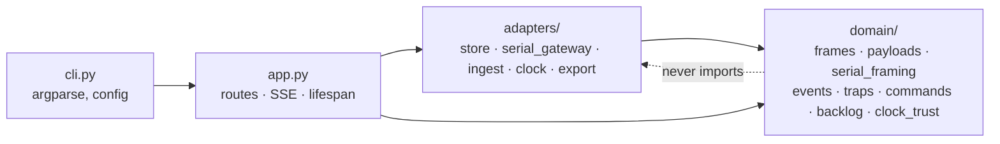
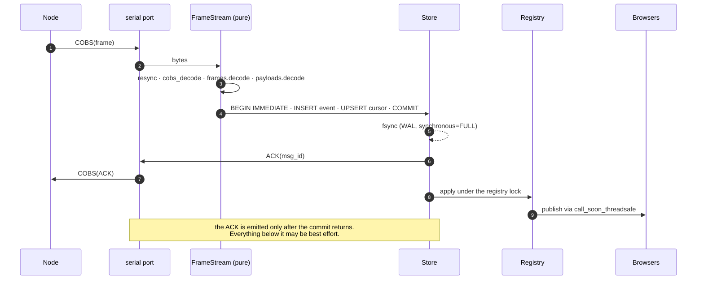
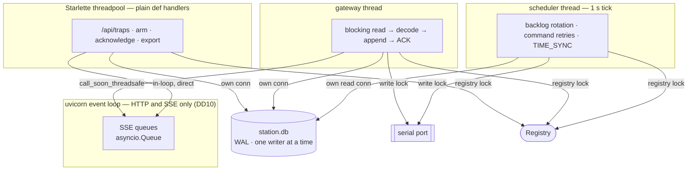

# Design — field station P4

Phase: `sdd-design`. Date: 2026-09-23. Reads `proposal.md`; **D1-D7 are settled and are not
re-opened here.** This document decides the *how*: where code lives, what the store looks like, in
what order bytes move, and how three incompatible concurrency models share one process.

## Decision index

| # | Decision | Section |
|---|----------|---------|
| DD1 | One slice is one pure module plus its adapter; adapters depend on `domain/`, never the reverse | 1 |
| DD2 | One append-only `event` log. Every piece of trap state is **derived** from it | 2 |
| DD3 | `seq INTEGER PRIMARY KEY AUTOINCREMENT` is the station's own sequence (D5) | 2 |
| DD4 | Store the bytes **and** the reading of them | 2 |
| DD5 | Every row records the clock trust that stamped it | 2 |
| DD6 | Dedup over a **count-bounded per-node window**, never a time window | 2 |
| DD7 | The backlog cursor is the *most recent accepted* `msg_id`, never the maximum | 2 |
| DD8 | A duplicate is **acknowledged**, not ignored | 3 |
| DD9 | Blocking pyserial on a thread — not `pyserial-asyncio`, not `add_reader` | 4, 7 |
| DD10 | The event loop serves HTTP and nothing else | 7 |
| DD11 | SSE publish crosses into the loop with `call_soon_threadsafe` | 7 |
| DD12 | No DuckDB on the station | 2 |
| DD13 | Export is `VACUUM INTO` a folder, plus CSV, plus a README | 8 |
| DD14 | Clock trust is probed, not assumed; an unset clock withholds `TIME_SYNC` (D7) | 5 |
| DD15 | A pending command is satisfied by the **reported state**, not by "armed" | 6 |
| DD16 | Two tiers of gateway test: a `SerialPort` Protocol, and a real pty | 4 |

---

## 1. Module layout

The repo already draws the line the right way: `frames.py` and `traps.py` are pure, `app.py` is a
shell. P4 extends that split rather than inventing a layer.

**DD1 — one slice, one pure module, one adapter.** Everything byte-exact or rule-shaped is pure and
tested with fixed values; everything that can fail in the world is an adapter tested against a fake.
Dependencies point one way only:



| File | Kind | Holds | Slice |
|------|------|-------|-------|
| `domain/frames.py` | pure, exists | 9-byte header codec | — |
| `domain/payloads.py` | pure, new | Payload codecs both directions; `SET_TARGETS` chunking into `seq`/`seq_total` | 1, 2 |
| `domain/serial_framing.py` | pure, new | COBS encode/decode, plus a `FrameStream` byte-in/blocks-out state machine that resynchronises at the next delimiter | 3 |
| `domain/events.py` | pure, new | `StationEvent` — the shape of a stored row — and `interpret(frame) -> StationEvent` | 4, 6 |
| `domain/traps.py` | pure, modified | Disarm, fault, desired-vs-reported target version, `rehydrate()` | 6, 8 |
| `domain/commands.py` | pure, new | Pending downlink table, backoff schedule, `satisfied_by(heartbeat)` | 8 |
| `domain/backlog.py` | pure, new | Round-robin `GET_BACKLOG` rotation; skip a silent node and retry next round | 7 |
| `domain/clock_trust.py` | pure, new | `ClockTrust` states and `may_distribute_time()` | 9 |
| `adapters/store.py` | I/O, new | SQLite: append, dedup, cursors, rehydration queries, snapshot | 4 |
| `adapters/serial_gateway.py` | I/O, new | pyserial, device resolution, reconnect, link state | 5 |
| `adapters/ingest.py` | I/O, new | **The only place that knows the S9 ordering** | 6 |
| `adapters/clock.py` | I/O, new | Probes the system clock, the RTC and NTP state | 9 |
| `adapters/export.py` | I/O, new | Consistent snapshot (D6) and event CSV (D1) | 11 |
| `config.py` | shell, new | Frozen `StationConfig` built from argv and `FEEDER_STATION_*` env | 4 |
| `static/index.html` | shell, new | The UI leaves `app.py`: a 400-line HTML string is not reviewable. Hatchling ships non-Python files inside the package, so nothing is fetched from a CDN (S8, S10) | 10 |

Purity is enforced, not hoped for: a test walks `src/feeder_station/domain/` and fails on any import
of `fastapi`, `serial`, `sqlite3`, `socket`, `pathlib`, `os` or `datetime.now`. Time is always a
parameter, exactly as `traps.py` already does it.

---

## 2. The store

### Schema

```sql
PRAGMA journal_mode = WAL;              -- persistent, set once at creation

CREATE TABLE meta (key TEXT PRIMARY KEY, value TEXT NOT NULL);   -- schema_version, station_id

CREATE TABLE event (
  seq            INTEGER PRIMARY KEY AUTOINCREMENT,  -- the station's own sequence (D5, DD3)
  node_seq       INTEGER,            -- per-node ordinal; NULL when source <> 'node'
  source         TEXT    NOT NULL,   -- 'node' | 'operator' | 'station'
  node_id        INTEGER NOT NULL,
  msg_type       INTEGER NOT NULL,
  msg_id         INTEGER,            -- the wire value: 16-bit, wraps, NOT a key (D5)
  received_epoch REAL    NOT NULL,   -- the station's clock when the frame arrived
  clock_trust    TEXT    NOT NULL,   -- what received_epoch was worth at that moment (DD5)
  node_epoch     INTEGER,            -- the node's own stamp, when the payload carries one
  tag            BLOB,               -- 7 raw reader bytes, when the payload carries one
  fields         TEXT    NOT NULL,   -- the decoded payload, as JSON
  payload        BLOB                -- the bytes exactly as received (DD4)
);

CREATE INDEX event_dedup     ON event(node_id, msg_id, node_seq DESC);
CREATE INDEX event_by_type   ON event(node_id, msg_type, seq DESC);

CREATE TABLE node_cursor (
  node_id       INTEGER PRIMARY KEY,
  last_msg_id   INTEGER NOT NULL,    -- what GET_BACKLOG asks after (DD7)
  last_seq      INTEGER NOT NULL,
  last_node_seq INTEGER NOT NULL
);
```

**DD2 — one log, everything derived.** There is no mutable `trap_state` table. A trap's state is the
latest `HEARTBEAT` row; a capture is the latest `CAPTURED` row with no later operator
acknowledgement. That is S4 made structural: *there is nowhere to write a state nobody reported.* It
also removes the whole class of "the cache disagrees with the log" bugs. Operator actions and the
station's own witnessed facts (a withheld `TIME_SYNC`, a link drop) are rows in the same log, which
is why `source` exists and why D1's export is a single ordered scan.

**DD3 — `AUTOINCREMENT`, not a bare rowid.** A plain `INTEGER PRIMARY KEY` is `max(rowid)+1`, so
deleting the tail (requirements open question 5, retention) would recycle a `seq` and silently
corrupt every cursor and dedup answer. `AUTOINCREMENT` guarantees never-reused. It costs one extra
row update inside the same transaction — no extra fsync.

**DD4 — the bytes and the reading of them.** `payload` is what arrived; `fields` is what we made of
it. Roughly 50 extra bytes per event, well under 100 KB/day network-wide. It buys re-decoding a
corpus after a codec bug is found, which is not recoverable any other way.

**DD5 — provenance per row.** `clock_trust` says what `received_epoch` was worth when it was
written. A station that ran for six hours with an unset clock produces rows that say so, instead of
rows that quietly claim 1970. `node_epoch` carries the node's own PCF8523 stamp beside it, so both
timestamps declare where they came from.

### PRAGMAs

| PRAGMA | Value | Why |
|--------|-------|-----|
| `journal_mode` | `WAL` | D2. One fsync of a small append per commit instead of the rollback journal's several; readers never block the writer, which is what lets the UI and the export run while frames land |
| `synchronous` | `FULL` | **S9.** `NORMAL` stays uncorrupted but can lose the most recent committed transaction on power loss — the exact event we just acknowledged. Per-connection: set on **every** connection open, including the export's |
| `busy_timeout` | `5000` | Two threads write (ingest, HTTP). WAL allows one writer at a time; without this a checkpoint or a concurrent commit raises `SQLITE_BUSY` instead of waiting 5 ms |
| `foreign_keys` | `ON` | Per-connection, costs nothing, catches a bad `capture_seq` reference early |
| `journal_size_limit` | `4194304` | Caps the `-wal` file's high-water mark after checkpoint. Without it the file stays as large as the busiest hour ever made it, on an SD card |
| `trusted_schema` | `OFF` | The file is copied to a USB drive and back (S14). A schema arriving from elsewhere should not be able to run anything |
| `quick_check` | at boot | Reported in `/health`. Full `integrity_check` stays on demand and in the crash-proxy test: it reads the whole file, and the store grows ~350 MB/year |

`wal_autocheckpoint` stays at its default (1000 pages ≈ 4 MB): at under 1 MB/day the WAL never
reaches it in a working day, so tuning it would be fiction.

### Dedup, and the `msg_id` wrap (D5)

**DD6 — a count-bounded per-node window, never a time window.** The window is `W = 32768` of *that
node's* accepted events:

```sql
SELECT seq FROM event
 WHERE node_id = :node AND msg_id = :msg_id AND node_seq > :last_node_seq - 32768
 ORDER BY node_seq DESC LIMIT 1;
```

The invariant, and it is unconditional: a node needs **65536** events to reuse a `msg_id`, so any
`W < 65536` makes it impossible for two events with the same `msg_id` to sit in the window at once.
`W = 32768` keeps a 2× margin and, at the design's 200 events/day, remembers about **164 days**.

It is a count and not a timestamp *because of D7*: a station whose clock is unset has a
`received_epoch` worth nothing, and a station that acquires NTP mid-run jumps. Dedup must not depend
on the one thing S12 says we may not trust.

**Honest bound:** a duplicate arriving more than 32768 events after the original is stored twice.
That needs the uplink to work while our ACK path is broken for ~164 days. It is detectable in the
export by `(node_id, msg_id)`, and it is recorded here rather than papered over.

**DD7 — the cursor is recency, not maximum.** `node_cursor.last_msg_id` is the `msg_id` of the most
recent *accepted* event ordered by our own `seq`. Taking `MAX(msg_id)` would be correct until the
wrap and then permanently wrong — after `0xFFFF → 0x0000` the station would ask for a backlog after
an id the node has already passed and never catch up again. `node_cursor` is written in the same
transaction as the insert, so it costs no extra fsync; boot recomputes it from the log and logs a
`station` row if the two disagree.

**DD12 — no DuckDB on the station.** The proposal left this to design. The export is one ordered
scan of one table into CSV: stdlib `sqlite3` does it in about twenty lines with no new dependency,
on an ARM Pi that may have to be set up without internet. DuckDB's value is *analytical* queries,
which happen in `feeder-analysis`, off-site, on a laptop, against the copied file — exactly where
D2's read-only `ATTACH` belongs. *Rejected:* shipping DuckDB as a station runtime dependency, which
adds tens of megabytes and an install step to the least serviceable machine in the project for a
query the station never runs.

---

## 3. The ingest path (S9)



| Where it fails | What the station does | Where that leaves us |
|----------------|-----------------------|----------------------|
| **1-3 decode** | Drop to the next `0x00`, bump `decode_errors`, no ACK | **S9 intact** — nothing was acknowledged. The node retries; the protocol already assumes an unreliable link |
| **4-5 commit + fsync** | No ACK. Mark the store unwritable in `/health`, `ok: false` | **S9 intact, and this is the whole point of the ordering.** The event stays on the node's SD card behind its cursor and arrives on the next `GET_BACKLOG` |
| **6-7 ACK send** | The event is stored; the link is marked down | **S9 intact.** The node retries and the duplicate is caught by DD6 — at the cost of one repeated transmission |
| **8 registry** | Already acked. The UI is stale | Not S9-critical. The next heartbeat corrects it (S4); a restart rebuilds from the log (§6) |
| **9 SSE** | Already acked. Nobody is pushed to | Not S9-critical. The state is in the page on the next load (S3); the push is an accelerator |

Only steps 4-5 are S9-critical. That is precisely what makes `Restart=always` safe rather than a
substitute for durability.

**DD8 — a duplicate is acknowledged, not ignored.** `Store.append` returns
`Appended(seq, node_seq, duplicate_of: int | None)`. When `duplicate_of` is set, no row is written
**and the ACK is still sent**. Silently dropping a duplicate makes the node retry forever: it only
stops when it hears an ACK, and we already hold the event.

---

## 4. The gateway

Pure COBS in `domain/serial_framing.py`; pyserial and everything that can fail in
`adapters/serial_gateway.py`.

**Device resolution, in order.** Never `/dev/ttyUSB0` blind:

1. An explicit `--serial-device` path — what the systemd unit will use once the hardware is known.
2. `/dev/serial/by-id/*` matching a configured substring.
3. VID:PID through `serial.tools.list_ports`.
4. Nothing matched → the link is `down`, `/health` says which step failed and with what, and the
   station keeps serving. **The gateway never pretends the link is up.**

**Reconnect.** `SerialException` on read or write → close, mark down, sleep `1, 2, 4, 8, 16, 30…`
seconds capped at 30, and **re-resolve the device from step 1 on every attempt** — a replugged
USB-CDC device is not guaranteed to return under the same name. `sleep` and `open_port` are injected,
so the whole state machine runs in milliseconds under test.

**Link state**, surfaced whole in `/health` and in the UI: `connected`, `device`, `since`,
`frames_in`, `frames_out`, `decode_errors`, `last_error`.

**DD16 — two tiers of test, no hardware.**

| Tier | How | Proves |
|------|-----|--------|
| Protocol fake | `SerialPort` Protocol (`read`/`write`/`close`) with a scripted in-memory implementation | Reconnect, backoff, ACK ordering, link state, decode-error counting — deterministic, no OS involvement |
| Real pty | `pty.openpty()`, the gateway opens the slave through real pyserial, the test drives the master | That real bytes survive real pyserial: framing, resync after injected corruption, partial reads split mid-frame |
| Byte vectors | Literal hex in both suites, as `test_frames.py` already does against `test_link_frame.c` | The C and Python COBS halves cannot drift apart |

**DD9 — a blocking read on a thread.** *Rejected:* `pyserial-asyncio` (a second, thinly maintained
dependency whose reconnect story we would have to write anyway); `loop.add_reader` on the tty fd
(works on Linux, but hand-rolls the termios setup pyserial exists to do). The blocking read is
pyserial's supported shape, and the thread boundary is one we need for SQLite regardless (§7).

---

## 5. Clock trust

**DD14.** Three states in `domain/clock_trust.py`, pure; the evidence is gathered in
`adapters/clock.py`.

| State | Evidence | `TIME_SYNC` | UI |
|-------|----------|-------------|-----|
| `unset` | No usable RTC read **and** NTP never synchronised, **or** the system clock is below an epoch floor baked in at release — a time before this software existed cannot be real, and 1970 and 2000-01-01 are exactly what an unset RTC reports | **Withheld (D7)** | "Reloj sin ajustar" banner |
| `rtc` | `/dev/rtc0` present and the boot-time read is above the floor. Carries the time across a power cut (S15) | Sent | normal |
| `ntp` | `adjtimex(2)` reports `STA_UNSYNC` clear | Sent | normal |

The primary probe is `adjtimex` through `ctypes`, because the target Pi OS image is unknown and
`chrony`, `ntpd` and `systemd-timesyncd` all maintain that kernel bit. A
`timedatectl show -p NTPSynchronized` fallback exists for images where it does not, and **the runbook
records which one was actually verified on the image that shipped.**

**Where the check lives: at the moment of sending, not at boot and not in unit ordering.** The
command sender asks `clock.trust()` immediately before emitting `TIME_SYNC`. If it is `unset` it
emits nothing (the protocol has no refusal frame — D7), writes a `station`-source row saying it
withheld and for which node, and shows it in the UI. The node sees silence; the station's own record
says exactly why.

---

## 6. Registry rehydration

At boot, before the HTTP server accepts, `adapters/store.py` replays a bounded tail into a pure
`traps.rehydrate()`. For each `node_id` in `node_cursor` — ten of them — each of these is a single
index seek on `event_by_type(node_id, msg_type, seq DESC)`:

1. Latest `HEARTBEAT` → `registry.heartbeat(...)`: state, battery, reported `targets_version`,
   `last_seen`.
2. Latest `CAPTURED`, and whether a later `operator/capture_acknowledged` row exists for that node.
   If not → `registry.captured(...)`. **This is what makes S3 survive a restart.**
3. Latest `operator/arm|disarm|set_targets` → the *desired* state and desired `targets_version`.

**The S4 invariant, and it is the reason this is a replay and not a snapshot:** the replay only ever
calls `registry.heartbeat()` with something a node said, and `registry.command_*()` with something an
operator asked. No code path writes a reported state that nobody reported. Pending is then derived —
desired versus reported — so a pending `SET_TARGETS` is still pending after a restart and is still
resent, which is the behaviour the protocol's `targets_version` contract requires.

Reachability is not rehydrated. Every trap starts unreachable until it beats again, because after an
outage the station genuinely does not know — which is what S11 asks for.

**DD15 — pending is satisfied by the reported state.** Today `traps.py` clears `arm_pending` when a
heartbeat reports `ARMED`, which cannot express a pending *disarm*. `domain/commands.py` replaces it
with `Command.satisfied_by(heartbeat)`: an `ARM` is answered by `state == ARMED`, a `DISARM` by
`state != ARMED`, a `SET_TARGETS` by `reported_targets_version == desired`. Anything unsatisfied is
resent on the backoff schedule.

---

## 7. Concurrency

Three models in one process: an asyncio event loop, a blocking serial library, and a database with
its own threading rules.



**DD10 — the event loop serves HTTP and nothing else.** Every SQLite call and every serial call
happens on a thread. This is one rule an implementer can hold in their head, and it is why the
existing plain `def` handlers are kept rather than converted to `async def`: Starlette already runs
them in the threadpool, so an operator write is a normal blocking SQLite call that cannot stall the
loop. Anything `async def` may not touch the store.

| Resource | Rule | Why |
|----------|------|-----|
| SQLite connections | One per thread, created lazily, each opened with the full PRAGMA set | `check_same_thread` exists for a reason. WAL plus `busy_timeout=5000` serialises the two writers; operator writes are a handful an hour and ingest commits are milliseconds |
| Serial writes | One `threading.Lock` around `port.write()` | *Rejected:* an outbound queue drained by a writer thread. It would turn "the ACK is sent after the commit" into "an ACK was queued after the commit" and quietly break the S9 ordering. A lock keeps step 6 of §3 literal |
| `Registry` | One `threading.Lock`, owned by the shell | Plain dicts mutated from three threads. The lock lives in the shell because `domain/` stays free of concurrency primitives, exactly as it stays free of clocks |
| SSE | `loop.call_soon_threadsafe(broadcaster.publish, event)` | **DD11, and a real bug in today's code:** `Broadcaster.publish` calls `Queue.put_nowait` on an `asyncio.Queue`, which is *not* thread-safe. Called straight from the gateway thread it corrupts the queue's internal state under load. The `Broadcaster` captures the running loop at lifespan startup and gains `publish_threadsafe()` |
| Shutdown | Lifespan sets stop flags, joins both threads with a timeout, runs `PRAGMA optimize`, closes | A clean `SIGTERM` path is what makes `Restart=always` a recovery mechanism rather than a corruption generator |

The gateway is **off by default** and turned on by `cli.py` when a device is configured, so
`tests/test_app.py` keeps running the lifespan with no threads and no hardware.

---

## 8. Export (D1, D6, S14)

**DD13 — one step produces one folder.**

```
station-export-20260923T141205Z/
├── station.db      VACUUM INTO — one statement, a consistent read transaction,
│                   a compacted copy, the live file untouched
├── events.csv      seq, source, node_id, msg_type, msg_id, received_utc,
│                   clock_trust, node_utc, tag_hex, fields_json
└── README.txt      "This is the station's own record of what it witnessed.
                     The scientific record is the node's SD card." (D1)
```

*Rejected:* `PRAGMA wal_checkpoint(TRUNCATE)` then `cp` — a write landing between the two silently
omits exactly the events S9 promised (D6). *Rejected:* `Connection.backup()` — correct, but it
copies page by page with retries and produces an uncompacted file; `VACUUM INTO` is one statement.
A startup assertion checks `sqlite3.sqlite_version_info >= (3, 27)`.

The destination is a path. The UI offers mount points found under `/media/*` and `/run/media/*`; the
runbook records the real one for the image that shipped. The provenance lives in the folder name and
the README, not in a `#` comment that would break a naive CSV reader.

---

## Interfaces

```python
# domain/events.py — pure
@dataclass(frozen=True)
class StationEvent:
    source: Source                      # 'node' | 'operator' | 'station'
    node_id: int
    msg_type: int
    msg_id: int | None                  # None unless source == 'node'
    node_epoch: int | None
    tag: bytes | None
    fields: Mapping[str, object]
    payload: bytes | None

def interpret(frame: Frame) -> StationEvent: ...

# adapters/store.py
@dataclass(frozen=True)
class Appended:
    seq: int
    node_seq: int | None
    duplicate_of: int | None            # drives DD8: ACK anyway

class Store:
    def append(self, event: StationEvent, *, received_epoch: float,
               clock_trust: ClockTrust) -> Appended: ...
    def cursor(self, node_id: int) -> Cursor | None: ...
    def latest(self, node_id: int, msg_type: int) -> StoredEvent | None: ...
    def snapshot_into(self, path: Path) -> None: ...

# adapters/serial_gateway.py
class SerialPort(Protocol):
    def read(self, size: int) -> bytes: ...
    # `int | None`, not `int`: pyserial's own typeshed stub declares
    # `Serial.write(Buffer, /) -> int | None`, so the narrower signature this
    # document originally carried fails mypy strict against the real class.
    # Corrected during slice 5. The gateway never reads the return value.
    def write(self, data: bytes) -> int | None: ...
    def close(self) -> None: ...

# adapters/clock.py
class Clock(Protocol):
    def now(self) -> datetime: ...
    def trust(self) -> ClockTrust: ...
```

`create_app(config, *, store=None, gateway=None, clock=None, registry=None)` keeps the existing
"optional injection, sensible default" shape so tests pass fakes and `cli.py` passes the real things.

---

## Testing strategy

| Layer | What | How |
|-------|------|-----|
| Pure | Payload codecs, COBS, frame header | Literal byte vectors shared with `feeder-node-firmware`, the pattern `test_frames.py` already sets |
| Pure | The `msg_id` wrap | Drive a node's counter through `0xFFFF → 0x0000`; assert nothing is dropped and nothing is wrongly deduplicated |
| Pure | Commands, backlog rotation, clock trust | Table-driven, time injected |
| Adapter | Store | `tmp_path` database; assert the PRAGMAs are actually set on every connection, including the export's |
| Adapter | Gateway | Protocol fake for the state machine, real pty for the bytes (DD16) |
| Adapter | Export | Snapshot **under concurrent writes**; assert every acknowledged event is in the copy (D6) |
| App | Routes, SSE, `/health` | `TestClient`, gateway disabled |
| Crash proxy | S9, in CI | Subprocess drives frames through the real write path, `kill -9` at randomised points, reopen; assert `integrity_check` is `ok` and every event the harness saw acknowledged is present |
| Scale | S5 | Ten simulated nodes over the pty; assert `/api/traps` stays responsive |
| **Hardware gate** | S9 physical, S15, S7, end-to-end | **Not runnable.** Named in the verify report as outstanding, never counted as green |

`uv run pytest`, `ruff` and `mypy --strict` stay clean on every slice. `types-pyserial` joins the dev
group; if the stubs prove wrong, the `SerialPort` Protocol narrows it instead of a `# type: ignore`.

---

## Migration and rollout

No data migration: `station.db` does not exist yet. The machinery ships anyway because the rollback
plan promises an older binary can open a newer file:

- `meta.schema_version`, written at creation, P4 ships `1`.
- A `_migrate()` of numbered steps, each inside one transaction. **Additive only** — new tables, or
  new nullable columns.
- **Always select named columns, never `SELECT *`.** That one rule is what keeps the promise: an
  added column cannot break an older reader.

Per-slice rollback is the proposal's. The gateway's kill switch is `--no-gateway`, which returns the
station to today's behaviour: UI and SSE, no radio.

---

## What cannot be verified without hardware

Stated plainly so a green suite is never mistaken for a working station:

- **Whether the SD card honours flush.** Everything above assumes it does; the crash proxy tests our
  code, not the medium. A UPS, or a USB SSD for `station.db`, remains the real mitigation.
- **Whether `/dev/serial/by-id` is stable.** It depends on the ESP32 board's USB-UART chip carrying a
  serial number in its descriptor. A CP2102 does; **a CH340 typically does not — and then neither
  `by-id` nor VID:PID distinguishes two identical boards,** and resolution falls back to an explicit
  `--serial-device` in the unit file. The board is unidentified.
- **A pty is not a USB-CDC device.** No DTR reset pulse, no hot-unplug errno, no real buffering. The
  reconnect path is tested honestly, but not against the failure it exists for.
- **The DS3231 on this Pi** — the overlay, the `hwclock` sequence and which NTP daemon the image runs.
- **The heartbeat interval** (protocol open question 4), which sets `silence_after`. The 5-minute
  default stays, configurable, and should be at least three missed beats.
- **Any true end-to-end exchange**, which needs `station_link` and a gateway ESP32 image that are not
  written yet.

---

## Open questions

- [ ] Which Raspberry Pi OS image — it decides `chrony` vs `timesyncd`, `/boot` vs `/boot/firmware`,
      and which clock probe in §5 is authoritative.
- [ ] The heartbeat interval, and therefore `silence_after` (S11's "agreed interval").
- [ ] Retention (requirements open question 5). DD3 makes deletion safe whenever it is decided; the
      policy itself is out of P4's scope.
- [ ] `messages.md` still defines `clock_source: 2 = GPS`, which the design removed. A protocol-doc
      fix, not a station one — recorded so it is not decoded as GPS by accident.

## Next

`sdd-tasks`, once `sdd-spec` is also ready.
